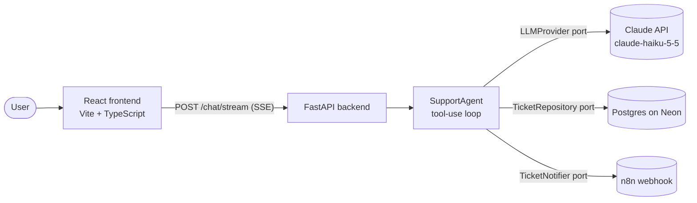
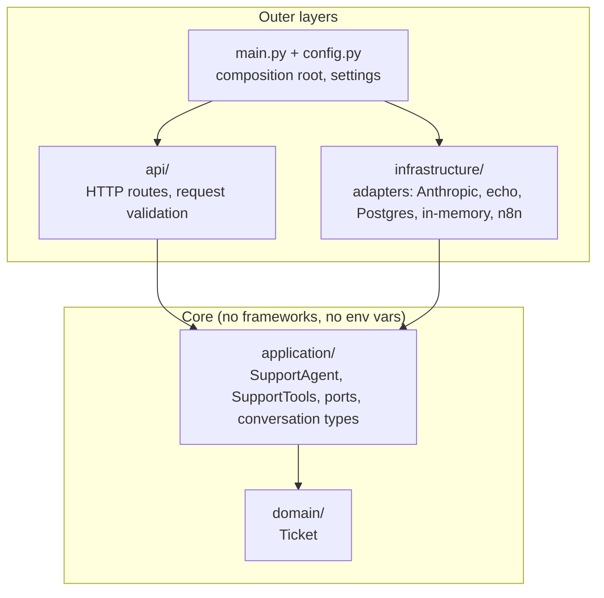
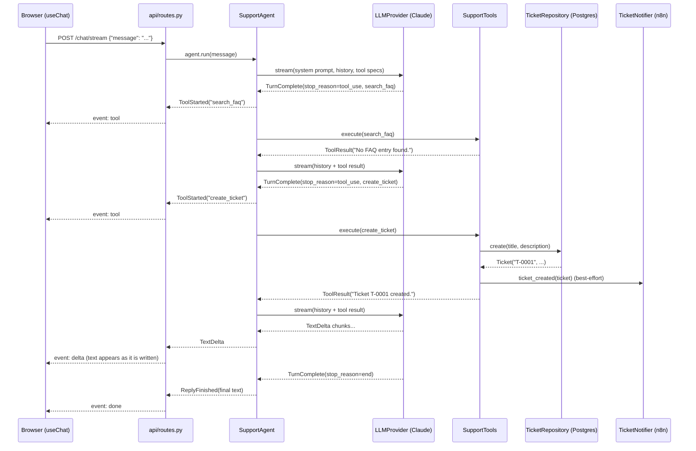

# Architecture

AI Support Assistant is a customer-support chat. A user writes a question in a React app; a FastAPI backend runs a Claude agent that searches an FAQ, answers in the user's language, and opens a support ticket when the FAQ has no answer. The reply streams to the browser token by token, tickets persist in Postgres (Neon), and an optional n8n webhook is notified for every new ticket.

The backend is built as a **hexagonal architecture** (ports and adapters): the business logic does not know which LLM, database, or notification channel it uses, so each one can be swapped or faked in tests without touching the core.

## At a glance



| Piece | Technology | Where |
|---|---|---|
| Frontend | React + TypeScript (Vite), Vitest | `frontend/` |
| Backend API | FastAPI, Server-Sent Events | `backend/app/api/` |
| Agent | Provider-neutral tool-use loop | `backend/app/application/` |
| LLM | Claude Haiku 5.5 via the Anthropic SDK; offline echo fallback | `backend/app/infrastructure/llm/` |
| Persistence | Postgres (Neon) via psycopg 3; in-memory fallback | `backend/app/infrastructure/` |
| Notifications | n8n webhook, best-effort | `backend/app/infrastructure/notifications.py`, `n8n/` |
| CI | GitHub Actions: backend tests, frontend lint + tests + build | `.github/workflows/` |

## The layers

Dependencies point **inward only**. Outer layers know inner ones; inner layers never import outer ones. A grep for `fastapi`, `anthropic`, `psycopg` or `os` in `domain/` and `application/` must come back empty.



| Layer | Responsibility | Key files |
|---|---|---|
| `domain/` | Business entities. Today: `Ticket(id, title, description)`. | `domain/ticket.py` |
| `application/` | Use cases: the agent loop, the tools, and the **ports** (interfaces) it needs. | `support_agent.py`, `support_tools.py`, `ports.py`, `conversation.py` |
| `infrastructure/` | **Adapters**: concrete implementations of the ports. | `llm/anthropic_provider.py`, `llm/echo_provider.py`, `postgres.py`, `in_memory.py`, `notifications.py` |
| `api/` | Translates HTTP into calls to the agent and agent events into HTTP. | `api/routes.py` |
| `main.py` | **Composition root**: the only place that decides which adapter plugs into which port. | `main.py` |
| `config.py` | Reads every environment variable in one place and validates it at startup. | `config.py` |

### Ports and adapters

A **port** is an interface the application declares ("I need something that can create tickets"). An **adapter** is a concrete implementation ("tickets stored in Postgres"). `main.py` picks the adapter from configuration:

| Port (`application/ports.py`) | Adapter used when... | Otherwise |
|---|---|---|
| `LLMProvider` | `ANTHROPIC_API_KEY` is set → `AnthropicProvider` | `EchoProvider` (offline mode, echoes the message) |
| `TicketRepository` | `DATABASE_URL` is set → `PostgresTicketRepository` | `InMemoryTicketRepository` (lost on restart) |
| `TicketNotifier` | `N8N_WEBHOOK_URL` is set → `N8nNotifier` | `NullNotifier` |
| `FaqRepository` | always `InMemoryFaqRepository` with the built-in FAQ | — |

Why it matters: tests run the real agent loop against fake adapters (`backend/tests/fakes.py`), the app works offline with no keys at all, and adding another LLM provider means writing one adapter, not rewriting the agent.

### The provider-neutral conversation

The agent never speaks Anthropic's wire format. It speaks its own types (`application/conversation.py`):

| Type | Meaning |
|---|---|
| `UserMessage`, `AssistantMessage`, `ToolResultsMessage` | The conversation history |
| `ToolSpec`, `ToolCall`, `ToolResult` | Tool definitions, the model's requests, and their results |
| `TextDelta` | A chunk of text, emitted as soon as the model produces it |
| `TurnComplete` | Last event of a model turn, carrying the whole message and a neutral `stop_reason` (`end`, `tool_use`, `max_tokens`, `refusal`) |

Each LLM adapter translates these to and from its provider. Anything the provider needs to replay verbatim (for example Claude's thinking blocks) travels in `AssistantMessage.provider_payload`, which no other layer inspects.

## Request flow

What happens when a user sends "I can't log in, my password reset email never arrived":



### The agent loop (`application/support_agent.py`)

1. Send the system prompt, the history, and the tool specs to the model.
2. Forward every `TextDelta` immediately, so the user sees text while the model writes.
3. When the turn ends:
   - `stop_reason` is `tool_use` → run each tool, emit `ToolStarted`, append the results, go back to step 1.
   - anything else → emit `ReplyFinished` with the final text and stop.
4. After `MAX_STEPS` (5) model turns without a final answer, give up with a fixed apology.

Safety nets: the final reply is never empty (an empty turn becomes an apology, a refusal becomes a polite refusal), unknown tools, bad arguments and failing adapters (for example the database being down) come back to the model as error results, so it can tell the user instead of the request crashing, and a failed n8n notification never undoes the ticket.

### Tools

| Tool | What it does | Port used |
|---|---|---|
| `search_faq(query)` | Returns FAQ answers whose topic (refund, shipping, password) appears in the query | `FaqRepository` |
| `create_ticket(title, description)` | Persists a ticket, notifies n8n, returns `Ticket T-0001 created.` | `TicketRepository`, `TicketNotifier` |

The system prompt tells the model to search the FAQ first and open a ticket only when there is no answer.

## Streaming (Server-Sent Events)

`POST /chat/stream` answers with `Content-Type: text/event-stream`. Each event is one frame:

```text
event: delta
data: {"text": "Your ticket"}

event: done
data: {"reply": "Your ticket T-0001 was created..."}
```

| Event | Data | Sent when |
|---|---|---|
| `delta` | `{"text"}` | A chunk of the reply is generated |
| `tool` | `{"name"}` | The agent starts running a tool |
| `done` | `{"reply"}` | The run finished; this text is authoritative |
| `error` | `{"message"}` | Something failed after the stream started (details are logged, never sent) |

Why SSE and not WebSockets: the conversation is one request and one streamed answer, so plain HTTP is enough, it works through proxies and serverless platforms, and the browser parses it with `fetch` and a stream reader.

On the frontend, `src/api/chatStream.ts` reads the stream and parses frames (including frames split across network chunks), and `src/hooks/useChat.ts` turns events into UI state: it appends deltas to the assistant bubble, shows tool activity, replaces the text with `done`, and reports a stream that closes without `done` or `error` as a failure. `App.tsx` only renders.

`POST /chat` still exists for clients that want a single JSON reply: it runs the same loop and returns `{"reply"}`.

## Persistence

| | Postgres (`DATABASE_URL` set) | In-memory (default) |
|---|---|---|
| Survives restarts and serverless instances | Yes | No |
| Used for | Production, real data | Tests, local development |

Table `tickets` (created by `python -m app.migrate`, idempotent):

| Column | Type |
|---|---|
| `id` | `BIGINT GENERATED ALWAYS AS IDENTITY` primary key, shown as `T-0001` |
| `title`, `description` | `TEXT NOT NULL` |
| `created_at` | `TIMESTAMPTZ`, defaults to `now()` |

Design decisions:

- **One short-lived connection per operation, no in-process pool.** On serverless an instance can be frozen or discarded at any time; Neon's pooled endpoint (`-pooler` host, PgBouncer) does the pooling server-side.
- **`prepare_threshold=None`.** PgBouncer in transaction mode cannot keep server-side prepared statements.
- **`connect_timeout` of 5 s.** On the free plan Neon suspends the compute after 5 minutes idle; the first query wakes it up, and a database that is really down fails fast.
- **No connection and no DDL at startup.** Cold starts stay fast and the API boots even if the database is down; the schema is created by an explicit migration command.

## Configuration

Every setting is read in `backend/app/config.py`. Locally, put them in `backend/.env` (git-ignored); in production, set them in the hosting platform.

| Variable | Purpose | Default |
|---|---|---|
| `ANTHROPIC_API_KEY` | Enables Claude | unset → offline echo |
| `ANTHROPIC_MODEL` | Model id | `claude-haiku-5-5` |
| `ANTHROPIC_EFFORT` | Reasoning effort; lower is faster | `low` |
| `DATABASE_URL` | Neon pooled connection string | unset → in-memory |
| `N8N_WEBHOOK_URL` | Ticket notification webhook | unset → no notification |
| `CORS_ORIGINS` | Origins allowed to call the API | `http://localhost:5173` |

Frontend: `VITE_API_URL` points to the backend (default `http://localhost:8000`).

## Running it

```bash
# Backend
cd backend
py -3.14 -m venv .venv && .venv\Scripts\activate
pip install -r requirements-dev.txt
python -m app.migrate                                   # only with DATABASE_URL
python -m uvicorn app.main:app --reload --env-file .env

# Frontend
cd frontend
npm install
npm run dev
```

## Testing

| Suite | Command | What it covers |
|---|---|---|
| Backend unit + API | `cd backend && python -m pytest` | Agent loop with fake LLMs, tools, SSE framing, settings, adapter selection, Anthropic adapter translation |
| Postgres integration | same, with `TEST_DATABASE_URL` set | Real database, each run in a throwaway schema that is dropped afterwards |
| Frontend | `cd frontend && npm test` | SSE parser (split frames, errors) and the `useChat` hook |

Ports make most tests fast and offline: the agent runs against scripted fake models, so no test needs an API key.

## Deployment

A free, portfolio-grade setup on two Vercel projects (Hobby plan) linked to the same GitHub repository:

| Component | Platform | Status |
|---|---|---|
| Database | Neon Postgres, AWS us-east-1, free plan | Done |
| Frontend | Vercel project `ai-support-assistant`, root `frontend/`, static Vite build | Live: https://ai-support-assistant-sigma.vercel.app |
| Backend | Vercel project `ai-support-assistant-api`, root `backend/`, FastAPI as a Python function in `iad1` | Live: https://ai-support-assistant-api.vercel.app |

Keeping the function and the database in the same region keeps every query a short round trip. `VITE_API_URL` (frontend) and `CORS_ORIGINS` (backend) point each project at the other; secrets (`DATABASE_URL`, `ANTHROPIC_API_KEY`) are set as sensitive variables in the Vercel dashboard. Vercel reads the Python version from `backend/.python-version` and installs only `backend/requirements.txt`; test tools live in `requirements-dev.txt`.

## Where to go next

- Add another LLM provider: implement `LLMProvider` in `infrastructure/llm/` and select it in `main.py`.
- Move the FAQ to Postgres: implement `FaqRepository` in `infrastructure/postgres.py`.
- Change what happens on a new ticket: implement `TicketNotifier`, or edit the n8n flow in `n8n/ticket-notification.json`.
